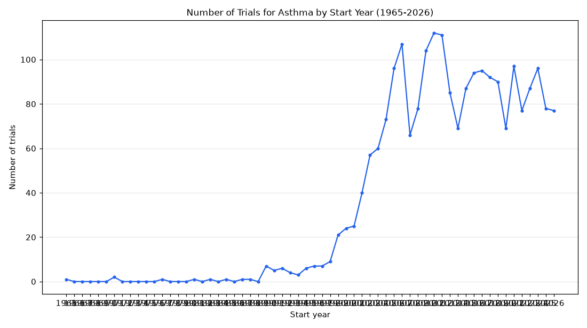

# 058. Pediatric asthma trials started per year

**Question:** Pediatric asthma trials started per year

Asked in **live** mode against `https://api.cheiron.engineeradriel.com` on 2026-10-24 22:51 UTC. [Open in the web app](https://trials.cheiron.engineeradriel.com/?q=Pediatric+asthma+trials+started+per+year&mode=live).

## Answer

- **Status:** `ok` (HTTP 200)
- **Time to answer:** 26.6 s
- **Title:** Number of Trials for Asthma by Start Year (1965-2026)
- **Chart:** `time_series`
- **Interpretation:** intent `trend`, dimension `start_year`, measure `trial_count`
- **Filters:** `{"conditions": ["asthma"], "age_groups": ["CHILD"]}`
- **Trials counted:** 2,230
- **ClinicalTrials.gov data of:** 2026-10-23T09:00:04

## Chart

## Data

| Start year | Number of trials | estimated_count |
|---|---|---|
| 1965 | 1 | 0 |
| 1966 | 0 | 0 |
| 1967 | 0 | 0 |
| 1968 | 0 | 0 |
| 1969 | 0 | 0 |
| 1970 | 0 | 0 |
| 1971 | 2 | 0 |
| 1972 | 0 | 0 |
| 1973 | 0 | 0 |
| 1974 | 0 | 0 |
| 1975 | 0 | 0 |
| 1976 | 0 | 0 |
| 1977 | 1 | 0 |
| 1978 | 0 | 0 |
| 1979 | 0 | 0 |
| 1980 | 0 | 0 |
| 1981 | 1 | 0 |
| 1982 | 0 | 0 |
| 1983 | 1 | 0 |
| 1984 | 0 | 0 |
| 1985 | 1 | 0 |
| 1986 | 0 | 0 |
| 1987 | 1 | 0 |
| 1988 | 1 | 0 |
| 1989 | 0 | 0 |
| 1990 | 7 | 0 |
| 1991 | 5 | 0 |
| 1992 | 6 | 0 |
| 1993 | 4 | 0 |
| 1994 | 3 | 0 |
| 1995 | 6 | 0 |
| 1996 | 7 | 0 |
| 1997 | 7 | 0 |
| 1998 | 9 | 0 |
| 1999 | 21 | 0 |
| 2000 | 24 | 0 |
| 2001 | 25 | 0 |
| 2002 | 40 | 0 |
| 2003 | 57 | 0 |
| 2004 | 60 | 0 |

_22 more rows in the API response._

## Counting rule

Each trial is counted once, in the year it started (or is expected to start).

## Assumptions

- Interpreted 'pediatric' as age group CHILD.

## Left out

- 13 trials: no start date
- 4 trials: start after 2026

## Sample citations

- `1965`: [NCT00005123](https://clinicaltrials.gov/study/NCT00005123) Honolulu Heart Program
- `1971`: [NCT00005279](https://clinicaltrials.gov/study/NCT00005279) Tucson Epidemiology Study of Chronic Obstructive Lung Diseases
- `1977`: [NCT00005281](https://clinicaltrials.gov/study/NCT00005281) Early Risk Predictors For Chronic Pulmonary Disease
- `1981`: [NCT00005282](https://clinicaltrials.gov/study/NCT00005282) Prospective Evaluation of Airways Reactivity
- `1983`: [NCT00005283](https://clinicaltrials.gov/study/NCT00005283) Risk Factors For Asthma in Laboratory Animal Allergy

## ClinicalTrials.gov queries

- [search](https://clinicaltrials.gov/api/v2/studies?filter.advanced=AREA%5BStdAge%5DCHILD&query.cond=%22asthma%22): 2,247 trials

## Timings (ms)

`{"plan": 3758, "count": 1483, "retrieve": 19710, "aggregate": 81, "narrate": 866, "total": 25910}`
