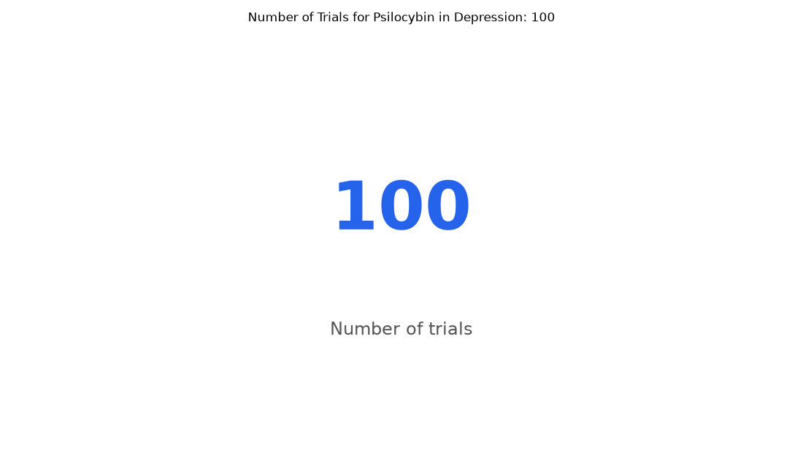

# 059. How many trials study psilocybin for depression?

**Question:** How many trials study psilocybin for depression?

Asked in **live** mode against `https://api.cheiron.engineeradriel.com` on 2026-10-24 22:52 UTC. [Open in the web app](https://trials.cheiron.engineeradriel.com/?q=How+many+trials+study+psilocybin+for+depression%3F&mode=live).

## Answer

- **Status:** `ok` (HTTP 200)
- **Time to answer:** 6.6 s
- **Title:** Number of Trials for Psilocybin in Depression: 100
- **Chart:** `metric`
- **Interpretation:** intent `single_number`, measure `trial_count`
- **Filters:** `{"drugs": ["psilocybin"], "conditions": ["depression"]}`
- **Trials counted:** 100
- **ClinicalTrials.gov data of:** 2026-10-23T09:00:04

## Chart

## Data

| Number of trials |
|---|
| 100 |

## Counting rule

Each matching trial is counted once.

## Assumptions

- Treating "study psilocybin for depression" as trials listing psilocybin and depression among their terms.

## Sample citations

- `all`: [NCT07499583](https://clinicaltrials.gov/study/NCT07499583) Psilocybin Assisted Psychotherapy for Treatment Resistant Depression and Co-occurring Substance Use Disorder

## ClinicalTrials.gov queries

- [search](https://clinicaltrials.gov/api/v2/studies?filter.advanced=AREA%5BInterventionNameSearch%5D%22psilocybin%22&query.cond=%22depression%22): 100 trials

## Timings (ms)

`{"plan": 1765, "count": 3462, "retrieve": 382, "aggregate": 3, "narrate": 860, "total": 6480}`
