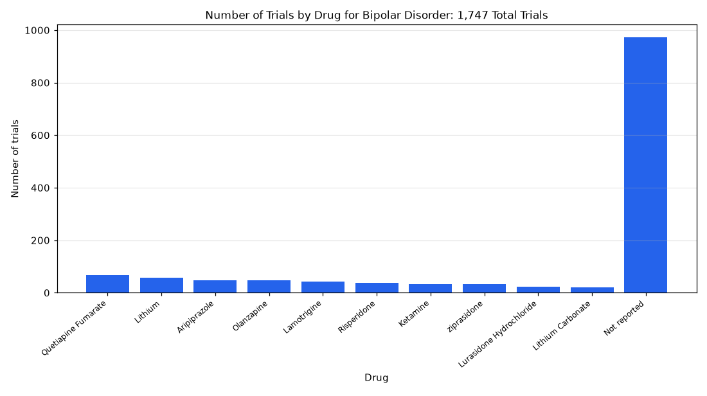

# 060. Which drugs are tested in bipolar disorder trials?

**Question:** Which drugs are tested in bipolar disorder trials?

Asked in **live** mode against `https://api.cheiron.engineeradriel.com` on 2026-10-24 22:48 UTC. [Open in the web app](https://trials.cheiron.engineeradriel.com/?q=Which+drugs+are+tested+in+bipolar+disorder+trials%3F&mode=live).

## Answer

- **Status:** `ok` (HTTP 200)
- **Time to answer:** 29.9 s
- **Title:** Number of Trials by Drug for Bipolar Disorder: 1,747 Total Trials
- **Chart:** `bar_chart`
- **Interpretation:** intent `top_n`, dimension `drug`, measure `trial_count`
- **Filters:** `{"conditions": ["bipolar disorder"]}`
- **Trials counted:** 1,747
- **ClinicalTrials.gov data of:** 2026-10-23T09:00:04

## Chart

## Data

| Drug | Number of trials |
|---|---|
| Quetiapine Fumarate | 68 |
| Lithium | 58 |
| Aripiprazole | 47 |
| Olanzapine | 47 |
| Lamotrigine | 43 |
| Risperidone | 38 |
| Ketamine | 33 |
| ziprasidone | 33 |
| Lurasidone Hydrochloride | 23 |
| Lithium Carbonate | 21 |
| Not reported | 972 |

## Counting rule

Each trial is counted once per distinct drug (placebo excluded) it lists.

## Assumptions

- Interpreting 'tested in bipolar disorder trials' as trials where bipolar disorder is a listed condition.

## Notes

- Showing the top 10 of 368 drugs.

## Sample citations

- `quetiapine fumarate`: [NCT07654348](https://clinicaltrials.gov/study/NCT07654348) Efficacy and Mechanism of IPSRT for Bipolar II Disorder
- `lithium`: [NCT06929273](https://clinicaltrials.gov/study/NCT06929273) A Study to Assess the Long-term Safety of KarXT for the Treatment of Manic Episodes in Bipolar-I Disorder (BAL
- `aripiprazole`: [NCT04812379](https://clinicaltrials.gov/study/NCT04812379) Specified Drug-use Survey on Abilify Prolonged Release Aqueous Suspension for IM Injection (Prevention of Rela
- `olanzapine`: [NCT07263191](https://clinicaltrials.gov/study/NCT07263191) A Study of Olanzapine in Participants With Bipolar Disorder.
- `lamotrigine`: [NCT06929273](https://clinicaltrials.gov/study/NCT06929273) A Study to Assess the Long-term Safety of KarXT for the Treatment of Manic Episodes in Bipolar-I Disorder (BAL

## ClinicalTrials.gov queries

- [search](https://clinicaltrials.gov/api/v2/studies?query.cond=%22bipolar+disorder%22): 1,747 trials

## Timings (ms)

`{"plan": 1864, "count": 7095, "retrieve": 19611, "aggregate": 66, "narrate": 913, "total": 29557}`
