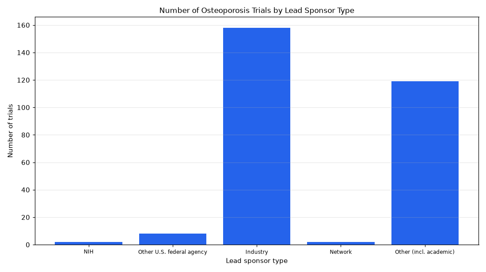

# 062. Number of osteoporosis trials completed with results by sponsor class

**Question:** Number of osteoporosis trials completed with results by sponsor class

Asked in **live** mode against `https://api.cheiron.engineeradriel.com` on 2026-10-24 22:49 UTC. [Open in the web app](https://trials.cheiron.engineeradriel.com/?q=Number+of+osteoporosis+trials+completed+with+results+by+sponsor+class&mode=live).

## Answer

- **Status:** `ok` (HTTP 200)
- **Time to answer:** 20.0 s
- **Title:** Number of Osteoporosis Trials by Lead Sponsor Type
- **Chart:** `bar_chart`
- **Interpretation:** intent `comparison`, dimension `sponsor_class`, measure `trial_count`
- **Filters:** `{"conditions": ["osteoporosis"], "statuses": ["COMPLETED"], "has_results": true}`
- **Trials counted:** 289
- **ClinicalTrials.gov data of:** 2026-10-23T09:00:04

## Chart

## Data

| Lead sponsor type | Number of trials |
|---|---|
| NIH | 2 |
| Other U.S. federal agency | 8 |
| Industry | 158 |
| Network | 2 |
| Other (incl. academic) | 119 |

## Counting rule

Each trial is counted once.

## Assumptions

- The query asks for sponsor class breakdown of trials matching the stated filters.

## Sample citations

- `NIH`: [NCT00104572](https://clinicaltrials.gov/study/NCT00104572) Effects of Aromatase Inhibition Versus Testosterone in Older Men With Low Testosterone: Randomized-Controlled 
- `FED`: [NCT04815824](https://clinicaltrials.gov/study/NCT04815824) Exercise Mode and Acute Bone Resorption
- `INDUSTRY`: [NCT06079476](https://clinicaltrials.gov/study/NCT06079476) A Study of Romosozumab (EVENITY®) in Postmenopausal Women in India With Osteoporosis at a High Risk of Fractur
- `NETWORK`: [NCT00329797](https://clinicaltrials.gov/study/NCT00329797) Zoledronate in Preventing Osteoporosis and Bone Fractures in Patients With Locally Advanced Nonmetastatic Pros
- `OTHER`: [NCT05326815](https://clinicaltrials.gov/study/NCT05326815) A Comparison of Serum and Urine N-telopeptide Marker

## ClinicalTrials.gov queries

- [search](https://clinicaltrials.gov/api/v2/studies?filter.advanced=AREA%5BHasResults%5Dtrue&filter.overallStatus=COMPLETED&query.cond=%22osteoporosis%22): 289 trials

## Timings (ms)

`{"plan": 1687, "count": 6948, "retrieve": 9370, "aggregate": 7, "narrate": 727, "total": 18746}`
