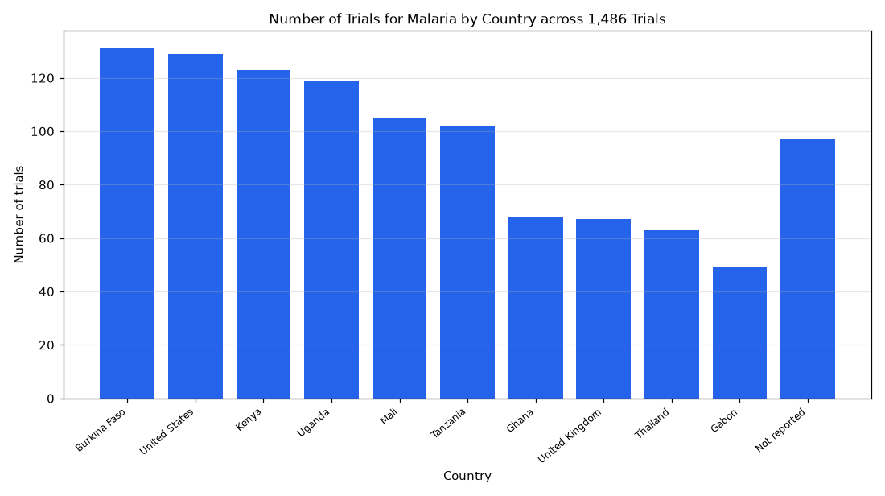

# 063. Top countries for malaria trials

**Question:** Top countries for malaria trials

Asked in **live** mode against `https://api.cheiron.engineeradriel.com` on 2026-10-24 22:51 UTC. [Open in the web app](https://trials.cheiron.engineeradriel.com/?q=Top+countries+for+malaria+trials&mode=live).

## Answer

- **Status:** `ok` (HTTP 200)
- **Time to answer:** 14.1 s
- **Title:** Number of Trials for Malaria by Country across 1,486 Trials
- **Chart:** `bar_chart`
- **Interpretation:** intent `top_n`, dimension `country`, measure `trial_count`
- **Filters:** `{"conditions": ["malaria"]}`
- **Trials counted:** 1,486
- **ClinicalTrials.gov data of:** 2026-10-23T09:00:04

## Chart

## Data

| Country | Number of trials |
|---|---|
| Burkina Faso | 131 |
| United States | 129 |
| Kenya | 123 |
| Uganda | 119 |
| Mali | 105 |
| Tanzania | 102 |
| Ghana | 68 |
| United Kingdom | 67 |
| Thailand | 63 |
| Gabon | 49 |
| Not reported | 97 |

## Counting rule

Each trial is counted once per country where it has at least one site.

## Assumptions

- 'Top countries' is interpreted as the top 10 countries by trial count.

## Notes

- Showing the top 10 of 78 countries.

## Sample citations

- `Burkina Faso`: [NCT07730177](https://clinicaltrials.gov/study/NCT07730177) Challenge Trial of PfSPZ-LARC2 Vaccine in Burkina Faso
- `United States`: [NCT07558122](https://clinicaltrials.gov/study/NCT07558122) Malaria CVD 36000; Gates INV090205
- `Kenya`: [NCT07811908](https://clinicaltrials.gov/study/NCT07811908) Platform Study to Evaluate the Efficacy and Safety of Anti-malarial Agents in Participants With Uncomplicated 
- `Uganda`: [NCT07773350](https://clinicaltrials.gov/study/NCT07773350) Insecticide-Treated Baby Wraps for the Prevention of Malaria
- `Mali`: [NCT05652504](https://clinicaltrials.gov/study/NCT05652504) Safety Evaluation of PfSPZ Vaccine in Pregnant Women in Mali (MalVIP1)

## ClinicalTrials.gov queries

- [search](https://clinicaltrials.gov/api/v2/studies?query.cond=%22malaria%22): 1,486 trials

## Timings (ms)

`{"plan": 1867, "count": 1284, "retrieve": 9780, "aggregate": 43, "narrate": 916, "total": 13898}`
