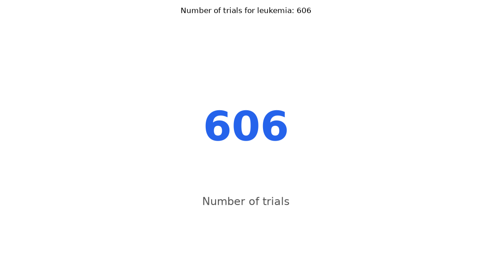

# 064. How many active not recruiting leukemia trials are there?

**Question:** How many active not recruiting leukemia trials are there?

Asked in **live** mode against `https://api.cheiron.engineeradriel.com` on 2026-10-24 22:51 UTC. [Open in the web app](https://trials.cheiron.engineeradriel.com/?q=How+many+active+not+recruiting+leukemia+trials+are+there%3F&mode=live).

## Answer

- **Status:** `ok` (HTTP 200)
- **Time to answer:** 7.6 s
- **Title:** Number of trials for leukemia: 606
- **Chart:** `metric`
- **Interpretation:** intent `single_number`, measure `trial_count`
- **Filters:** `{"conditions": ["leukemia"], "statuses": ["ACTIVE_NOT_RECRUITING"]}`
- **Trials counted:** 606
- **ClinicalTrials.gov data of:** 2026-10-23T09:00:04

## Chart

## Data

| Number of trials |
|---|
| 606 |

## Counting rule

Each matching trial is counted once.

## Sample citations

- `all`: [NCT07651475](https://clinicaltrials.gov/study/NCT07651475) Study of the Beach Regimen on Relapsed/Refractory Acute Myeloid Leukemia (R/R AML)

## ClinicalTrials.gov queries

- [search](https://clinicaltrials.gov/api/v2/studies?filter.overallStatus=ACTIVE_NOT_RECRUITING&query.cond=%22leukemia%22): 606 trials

## Timings (ms)

`{"plan": 1479, "count": 2707, "retrieve": 2337, "aggregate": 11, "narrate": 863, "total": 7405}`
