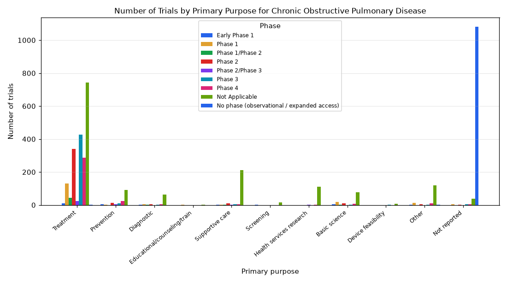

# 065. Trials for chronic obstructive pulmonary disease by primary purpose and phase

**Question:** Trials for chronic obstructive pulmonary disease by primary purpose and phase

Asked in **live** mode against `https://api.cheiron.engineeradriel.com` on 2026-10-24 22:50 UTC. [Open in the web app](https://trials.cheiron.engineeradriel.com/?q=Trials+for+chronic+obstructive+pulmonary+disease+by+primary+purpose+and+phase&mode=live).

## Answer

- **Status:** `ok` (HTTP 200)
- **Time to answer:** 36.6 s
- **Title:** Number of Trials by Primary Purpose for Chronic Obstructive Pulmonary Disease
- **Chart:** `grouped_bar_chart`
- **Interpretation:** intent `comparison`, dimension `primary_purpose`, dimension_2 `phase`, measure `trial_count`
- **Filters:** `{"conditions": ["chronic obstructive pulmonary disease"]}`
- **Trials counted:** 4,029
- **ClinicalTrials.gov data of:** 2026-10-23T09:00:04

## Chart

## Data

| Primary purpose | Phase | Number of trials |
|---|---|---|
| Treatment | Early Phase 1 | 11 |
| Prevention | Early Phase 1 | 4 |
| Diagnostic | Early Phase 1 | 3 |
| Educational/counseling/training | Early Phase 1 | 0 |
| Supportive care | Early Phase 1 | 2 |
| Screening | Early Phase 1 | 2 |
| Health services research | Early Phase 1 | 0 |
| Basic science | Early Phase 1 | 5 |
| Device feasibility | Early Phase 1 | 0 |
| Other | Early Phase 1 | 1 |
| Not reported | Early Phase 1 | 0 |
| Treatment | Phase 1 | 131 |
| Prevention | Phase 1 | 1 |
| Diagnostic | Phase 1 | 4 |
| Educational/counseling/training | Phase 1 | 1 |
| Supportive care | Phase 1 | 2 |
| Screening | Phase 1 | 0 |
| Health services research | Phase 1 | 0 |
| Basic science | Phase 1 | 18 |
| Device feasibility | Phase 1 | 0 |
| Other | Phase 1 | 14 |
| Not reported | Phase 1 | 6 |
| Treatment | Phase 1/Phase 2 | 44 |
| Prevention | Phase 1/Phase 2 | 0 |
| Diagnostic | Phase 1/Phase 2 | 2 |
| Educational/counseling/training | Phase 1/Phase 2 | 0 |
| Supportive care | Phase 1/Phase 2 | 1 |
| Screening | Phase 1/Phase 2 | 0 |
| Health services research | Phase 1/Phase 2 | 0 |
| Basic science | Phase 1/Phase 2 | 2 |
| Device feasibility | Phase 1/Phase 2 | 0 |
| Other | Phase 1/Phase 2 | 0 |
| Not reported | Phase 1/Phase 2 | 0 |
| Treatment | Phase 2 | 340 |
| Prevention | Phase 2 | 12 |
| Diagnostic | Phase 2 | 6 |
| Educational/counseling/training | Phase 2 | 0 |
| Supportive care | Phase 2 | 9 |
| Screening | Phase 2 | 0 |
| Health services research | Phase 2 | 0 |

_59 more rows in the API response._

## Counting rule

Each trial is counted once.

## Sample citations

- `Early Phase 1|TREATMENT`: [NCT07355868](https://clinicaltrials.gov/study/NCT07355868) Treatment of Chronic Obstructive Pulmonary Disease (COPD) by REGEND007 Cell Therapy
- `Early Phase 1|PREVENTION`: [NCT05539547](https://clinicaltrials.gov/study/NCT05539547) Effect of NMES on Quadriceps Muscle Strength and Endurance in Patients With COPD
- `Early Phase 1|DIAGNOSTIC`: [NCT02748798](https://clinicaltrials.gov/study/NCT02748798) Developing Optimal Parameters for Hyperpolarized Noble Gas and Inert Fluorinated Gas MRI of Lung Disorders
- `Early Phase 1|SUPPORTIVE_CARE`: [NCT01650480](https://clinicaltrials.gov/study/NCT01650480) HELPing Older People With Very Severe Chronic Obstructive Pulmonary Disease Towards the End of Their Lives: De
- `Early Phase 1|SCREENING`: [NCT01576068](https://clinicaltrials.gov/study/NCT01576068) Chronic Obstructive Pulmonary Disease Case Finding in Community-pharmacies by Spirometry

## ClinicalTrials.gov queries

- [search](https://clinicaltrials.gov/api/v2/studies?query.cond=%22chronic+obstructive+pulmonary+disease%22): 4,029 trials

## Timings (ms)

`{"plan": 1587, "count": 2529, "retrieve": 30381, "aggregate": 444, "narrate": 694, "total": 35644}`
