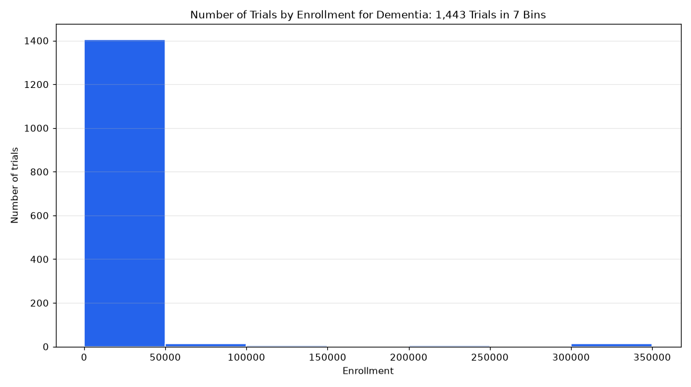

# 066. Distribution of enrollment in observational studies of dementia

**Question:** Distribution of enrollment in observational studies of dementia

Asked in **live** mode against `https://api.cheiron.engineeradriel.com` on 2026-10-24 22:54 UTC. [Open in the web app](https://trials.cheiron.engineeradriel.com/?q=Distribution+of+enrollment+in+observational+studies+of+dementia&mode=live).

## Answer

- **Status:** `ok` (HTTP 200)
- **Time to answer:** 1.2 s (a stored answer)
- **Title:** Number of Trials by Enrollment for Dementia: 1,443 Trials in 7 Bins
- **Chart:** `histogram`
- **Interpretation:** intent `numeric_distribution`, dimension `enrollment`, measure `trial_count`
- **Filters:** `{"conditions": ["dementia"], "study_types": ["OBSERVATIONAL"]}`
- **Trials counted:** 1,443
- **ClinicalTrials.gov data of:** 2026-10-23T09:00:04

## Chart

## Data

| Enrollment | to | Number of trials |
|---|---|---|
| 0 | 50,000 | 1,405 |
| 50,000 | 100,000 | 12 |
| 100,000 | 150,000 | 5 |
| 150,000 | 200,000 | 1 |
| 200,000 | 250,000 | 5 |
| 250,000 | 300,000 | 1 |
| 300,000 | None | 14 |

## Counting rule

One value per trial: its enrollment (actual or estimated).

## Assumptions

- Interpret 'observational studies' as study type OBSERVATIONAL.

## Notes

- Bins are 50000 wide; values above 280000 (99th percentile) overflow.

## Left out

- 6 trials: no enrollment reported

## Sample citations

- `0-50000`: [NCT07871487](https://clinicaltrials.gov/study/NCT07871487) Tau Pathology in the Brain After Hip or Knee Replacement Surgery
- `50000-100000`: [NCT07679906](https://clinicaltrials.gov/study/NCT07679906) ALZEVIT: Nationwide Digital APOE ε4 Cohort for Early Alzheimer's Disease Prevention and Trial Readiness
- `100000-150000`: [NCT05817188](https://clinicaltrials.gov/study/NCT05817188) Medication Repurposing to Stop Cognitive Decline in Dementia
- `150000-200000`: [NCT03687112](https://clinicaltrials.gov/study/NCT03687112) National Bank Alzheimer
- `200000-250000`: [NCT03987633](https://clinicaltrials.gov/study/NCT03987633) EMPOWER-1: A Multi-site Clinical Cohort Research Study to Reduce Health Inequality

## ClinicalTrials.gov queries

- [search](https://clinicaltrials.gov/api/v2/studies?filter.advanced=AREA%5BStudyType%5DOBSERVATIONAL&query.cond=%22dementia%22): 1,449 trials

## Timings (ms)

`{"plan": 3476, "count": 3324, "total": 18267, "narrate": 835, "retrieve": 10543, "aggregate": 81}`
