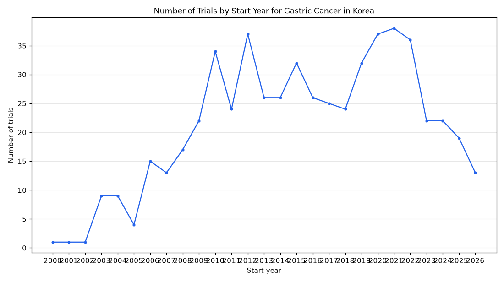

# 068. Trials in Korea for gastric cancer by start year

**Question:** Trials in Korea for gastric cancer by start year

Asked in **live** mode against `https://api.cheiron.engineeradriel.com` on 2026-10-24 22:52 UTC. [Open in the web app](https://trials.cheiron.engineeradriel.com/?q=Trials+in+Korea+for+gastric+cancer+by+start+year&mode=live).

## Answer

- **Status:** `ok` (HTTP 200)
- **Time to answer:** 11.2 s
- **Title:** Number of Trials by Start Year for Gastric Cancer in Korea
- **Chart:** `time_series`
- **Interpretation:** intent `trend`, dimension `start_year`, measure `trial_count`
- **Filters:** `{"conditions": ["gastric cancer"], "countries": ["Korea"]}`
- **Trials counted:** 565
- **ClinicalTrials.gov data of:** 2026-10-23T09:00:04

## Chart

## Data

| Start year | Number of trials | estimated_count |
|---|---|---|
| 2000 | 1 | 0 |
| 2001 | 1 | 0 |
| 2002 | 1 | 0 |
| 2003 | 9 | 0 |
| 2004 | 9 | 0 |
| 2005 | 4 | 0 |
| 2006 | 15 | 0 |
| 2007 | 13 | 0 |
| 2008 | 17 | 0 |
| 2009 | 22 | 0 |
| 2010 | 34 | 0 |
| 2011 | 24 | 0 |
| 2012 | 37 | 0 |
| 2013 | 26 | 0 |
| 2014 | 26 | 0 |
| 2015 | 32 | 0 |
| 2016 | 26 | 0 |
| 2017 | 25 | 1 |
| 2018 | 24 | 0 |
| 2019 | 32 | 1 |
| 2020 | 37 | 1 |
| 2021 | 38 | 2 |
| 2022 | 36 | 4 |
| 2023 | 22 | 4 |
| 2024 | 22 | 0 |
| 2025 | 19 | 1 |
| 2026 | 13 | 5 |

## Counting rule

Each trial is counted once, in the year it started (or is expected to start).

## Assumptions

- Interpreting 'Korea' as the country filter exactly as written.

## Left out

- 2 trials: no start date

## Sample citations

- `2000`: [NCT01961791](https://clinicaltrials.gov/study/NCT01961791) Lymph Node Staging System With a Novel Concept for Gastric Cancer: a Hybrid Type of Topographic and Numeric On
- `2001`: [NCT00296322](https://clinicaltrials.gov/study/NCT00296322) Trial of Adjuvant Chemotherapy for Gastric Cancer
- `2002`: [NCT00296335](https://clinicaltrials.gov/study/NCT00296335) Trial of Adjuvant Chemotherapy for Gastric Cancer
- `2003`: [NCT00190801](https://clinicaltrials.gov/study/NCT00190801) Phase 2 Study on Use of a Combination of Pemetrexed in Patients With Advanced Gastric Carcinoma
- `2004`: [NCT00278863](https://clinicaltrials.gov/study/NCT00278863) Capecitabine Versus S-1 in Elderly Advanced Gastric Cancer (AGC): Randomized Trial

## ClinicalTrials.gov queries

- [search](https://clinicaltrials.gov/api/v2/studies?filter.advanced=AREA%5BLocationCountry%5D%22South+Korea%22&query.cond=%22gastric+cancer%22): 567 trials

## Timings (ms)

`{"plan": 1952, "count": 6418, "retrieve": 1851, "aggregate": 28, "narrate": 706, "total": 10965}`
