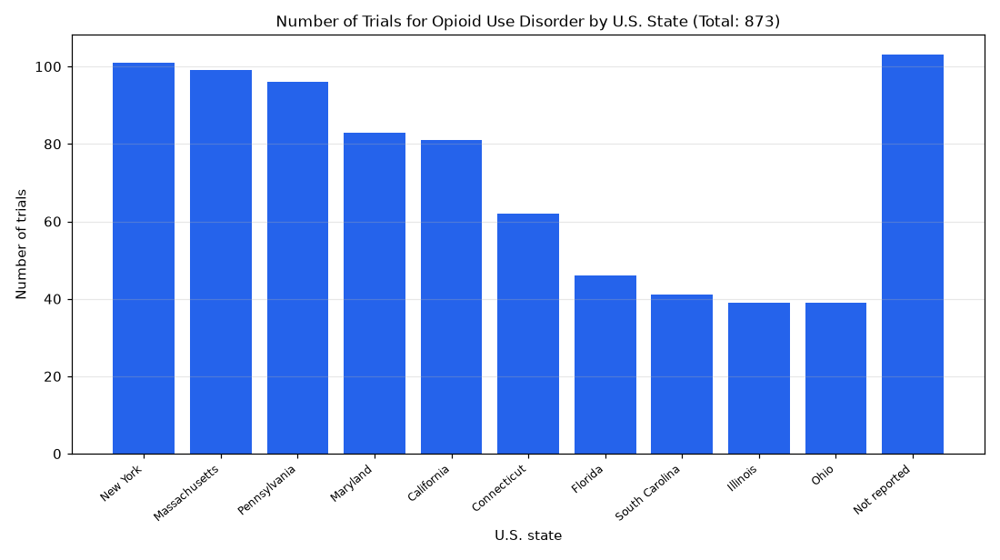

# 069. Which US states run the most opioid use disorder trials?

**Question:** Which US states run the most opioid use disorder trials?

Asked in **live** mode against `https://api.cheiron.engineeradriel.com` on 2026-10-24 22:49 UTC. [Open in the web app](https://trials.cheiron.engineeradriel.com/?q=Which+US+states+run+the+most+opioid+use+disorder+trials%3F&mode=live).

## Answer

- **Status:** `ok` (HTTP 200)
- **Time to answer:** 14.6 s
- **Title:** Number of Trials for Opioid Use Disorder by U.S. State (Total: 873)
- **Chart:** `bar_chart`
- **Interpretation:** intent `top_n`, dimension `us_state`, measure `trial_count`
- **Filters:** `{"conditions": ["opioid use disorder"]}`
- **Trials counted:** 873
- **ClinicalTrials.gov data of:** 2026-10-23T09:00:04

## Chart

## Data

| U.S. state | Number of trials |
|---|---|
| New York | 101 |
| Massachusetts | 99 |
| Pennsylvania | 96 |
| Maryland | 83 |
| California | 81 |
| Connecticut | 62 |
| Florida | 46 |
| South Carolina | 41 |
| Illinois | 39 |
| Ohio | 39 |
| Not reported | 103 |

## Counting rule

Each trial is counted once per U.S. state where it has at least one site.

## Assumptions

- Interpreting 'run' as trials conducted in the state.

## Notes

- Showing the top 10 of 49 u.s. states.

## Sample citations

- `New York`: [NCT06766331](https://clinicaltrials.gov/study/NCT06766331) Integrated Care Versus Usual Care for Opioid Use Disorder and Infectious Diseases in Veterans
- `Massachusetts`: [NCT07216963](https://clinicaltrials.gov/study/NCT07216963) The Community Paramedic Response and Overdose Outreach With Supportive Medical-Legal Services Study
- `Pennsylvania`: [NCT07406828](https://clinicaltrials.gov/study/NCT07406828) Psilocybin After Trauma Surgery for Pain
- `Maryland`: [NCT06005662](https://clinicaltrials.gov/study/NCT06005662) Inpatient Buprenorphine Induction With Psilocybin for Opioid Use Disorder
- `California`: [NCT07011758](https://clinicaltrials.gov/study/NCT07011758) Dynamic Treatment Regimes for Opioid Use Disorder

## ClinicalTrials.gov queries

- [search](https://clinicaltrials.gov/api/v2/studies?query.cond=%22opioid+use+disorder%22): 873 trials

## Timings (ms)

`{"plan": 3207, "count": 1533, "retrieve": 8716, "aggregate": 31, "narrate": 964, "total": 14464}`
