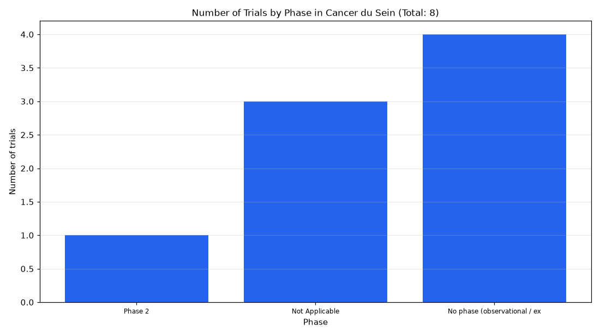

# 081. Quels sont les essais cliniques sur le cancer du sein par phase?

**Question:** Quels sont les essais cliniques sur le cancer du sein par phase?

Asked in **live** mode against `https://api.cheiron.engineeradriel.com` on 2026-10-24 22:51 UTC. [Open in the web app](https://trials.cheiron.engineeradriel.com/?q=Quels+sont+les+essais+cliniques+sur+le+cancer+du+sein+par+phase%3F&mode=live).

## Answer

- **Status:** `ok` (HTTP 200)
- **Time to answer:** 4.1 s
- **Title:** Number of Trials by Phase in Cancer du Sein (Total: 8)
- **Chart:** `bar_chart`
- **Interpretation:** intent `distribution`, dimension `phase`, measure `trial_count`
- **Filters:** `{"conditions": ["cancer du sein"]}`
- **Trials counted:** 8
- **ClinicalTrials.gov data of:** 2026-10-23T09:00:04

## Chart

## Data

| Phase | Number of trials |
|---|---|
| Phase 2 | 1 |
| Not Applicable | 3 |
| No phase (observational / expanded access) | 4 |

## Counting rule

Each trial is counted once; trials with two phases get a combined bucket (e.g. Phase 2/Phase 3).

## Assumptions

- La condition demandée est interprétée comme le cancer du sein.

## Sample citations

- `PHASE2`: [NCT02970500](https://clinicaltrials.gov/study/NCT02970500) Effect of Methylphenidate on Cancer-related Cognitive Impairment
- `NA`: [NCT05800132](https://clinicaltrials.gov/study/NCT05800132) Diagnostic Performance of Breast Cancer Screening Second Reading Process Assisted by AI
- `NO_PHASE`: [NCT06418139](https://clinicaltrials.gov/study/NCT06418139) Association of Pembrolizumab Infusion Time and Efficacy in Patients With Non-metastatic Triple-negative Breast

## ClinicalTrials.gov queries

- [search](https://clinicaltrials.gov/api/v2/studies?query.cond=%22cancer+du+sein%22): 8 trials

## Timings (ms)

`{"plan": 1825, "count": 943, "retrieve": 433, "aggregate": 0, "narrate": 785, "total": 3996}`
