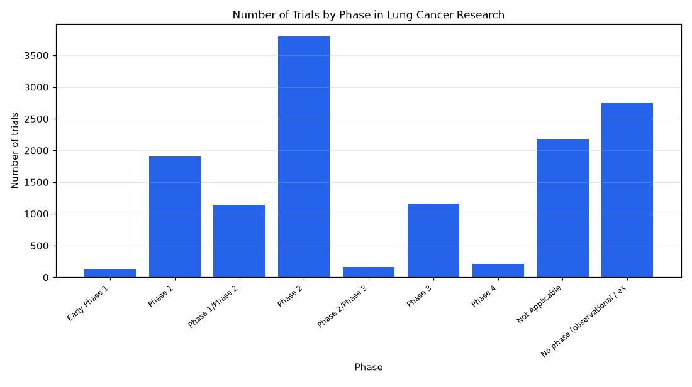

# 082. lung canser trials by phse

**Question:** lung canser trials by phse

Asked in **live** mode against `https://api.cheiron.engineeradriel.com` on 2026-10-24 22:52 UTC. [Open in the web app](https://trials.cheiron.engineeradriel.com/?q=lung+canser+trials+by+phse&mode=live).

## Answer

- **Status:** `ok` (HTTP 200)
- **Time to answer:** 62.2 s
- **Title:** Number of Trials by Phase in Lung Cancer Research
- **Chart:** `bar_chart`
- **Interpretation:** intent `distribution`, dimension `phase`, measure `trial_count`
- **Filters:** `{"conditions": ["lung cancer"]}`
- **Trials counted:** 13,423
- **ClinicalTrials.gov data of:** 2026-10-23T09:00:04

## Chart

## Data

| Phase | Number of trials |
|---|---|
| Early Phase 1 | 131 |
| Phase 1 | 1,904 |
| Phase 1/Phase 2 | 1,140 |
| Phase 2 | 3,802 |
| Phase 2/Phase 3 | 161 |
| Phase 3 | 1,159 |
| Phase 4 | 206 |
| Not Applicable | 2,168 |
| No phase (observational / expanded access) | 2,752 |

## Counting rule

Each trial is counted once; trials with two phases get a combined bucket (e.g. Phase 2/Phase 3).

## Assumptions

- Interpreting the misspelled query as lung cancer trials by phase.

## Sample citations

- `EARLY_PHASE1`: [NCT07892300](https://clinicaltrials.gov/study/NCT07892300) Implantable Microdevices for in Situ Evaluation of Drug Responses in Lung Cancer
- `PHASE1`: [NCT04266730](https://clinicaltrials.gov/study/NCT04266730) Trial of a Personalized and Adaptive Neoantigen Dose-Adjusted Vaccine Concurrently With Pembrolizumab
- `PHASE1/PHASE2`: [NCT05745740](https://clinicaltrials.gov/study/NCT05745740) A Study of RC48-ADC Combined With Pyrotinib For Treatment of Local Advanced or Metastasis NSCLC With HER2 Muta
- `PHASE2`: [NCT07229339](https://clinicaltrials.gov/study/NCT07229339) Zipalertinib With Carboplatin and Pemetrexed for the Treatment of Resectable, Stage II-IIIB, Non-Small Cell Lu
- `PHASE2/PHASE3`: [NCT07888075](https://clinicaltrials.gov/study/NCT07888075) OLE Study Subsequent to Parent Study of Rilogrotug for the Treatment of Weight Loss and Anorexia in Patients W

## ClinicalTrials.gov queries

- [search](https://clinicaltrials.gov/api/v2/studies?query.cond=%22lung+cancer%22): 13,423 trials

## Timings (ms)

`{"plan": 3884, "count": 3639, "retrieve": 52223, "aggregate": 698, "narrate": 814, "total": 61265}`
