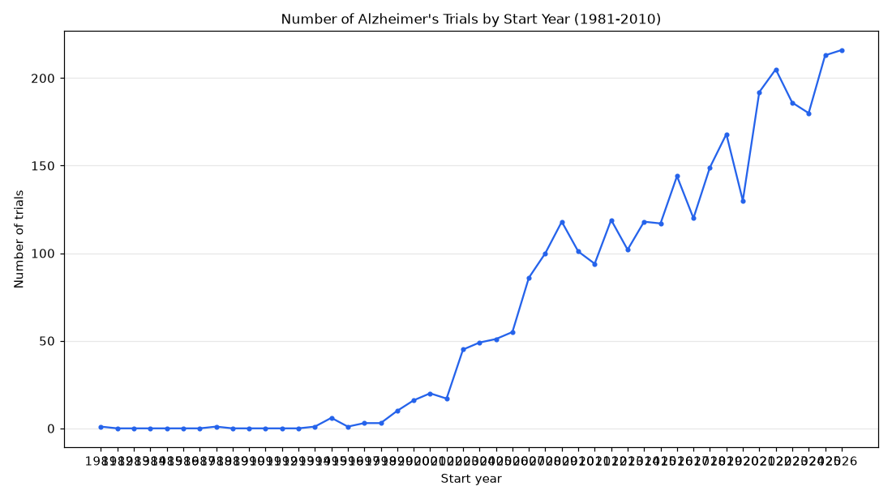

# 083. How did the number of Alzheimer's trials change before and after 2015?

**Question:** How did the number of Alzheimer's trials change before and after 2015?

Asked in **live** mode against `https://api.cheiron.engineeradriel.com` on 2026-10-24 22:50 UTC. [Open in the web app](https://trials.cheiron.engineeradriel.com/?q=How+did+the+number+of+Alzheimer%27s+trials+change+before+and+after+2015%3F&mode=live).

## Answer

- **Status:** `ok` (HTTP 200)
- **Time to answer:** 22.5 s
- **Title:** Number of Alzheimer's Trials by Start Year (1981-2010)
- **Chart:** `time_series`
- **Interpretation:** intent `trend`, dimension `start_year`, measure `trial_count`
- **Filters:** `{"conditions": ["Alzheimer's"], "start_year_max": 2026}`
- **Trials counted:** 3,137
- **ClinicalTrials.gov data of:** 2026-10-23T09:00:04

## Chart

## Data

| Start year | Number of trials | estimated_count |
|---|---|---|
| 1981 | 1 | 0 |
| 1982 | 0 | 0 |
| 1983 | 0 | 0 |
| 1984 | 0 | 0 |
| 1985 | 0 | 0 |
| 1986 | 0 | 0 |
| 1987 | 0 | 0 |
| 1988 | 1 | 0 |
| 1989 | 0 | 0 |
| 1990 | 0 | 0 |
| 1991 | 0 | 0 |
| 1992 | 0 | 0 |
| 1993 | 0 | 0 |
| 1994 | 1 | 0 |
| 1995 | 6 | 0 |
| 1996 | 1 | 0 |
| 1997 | 3 | 0 |
| 1998 | 3 | 0 |
| 1999 | 10 | 0 |
| 2000 | 16 | 0 |
| 2001 | 20 | 0 |
| 2002 | 17 | 0 |
| 2003 | 45 | 0 |
| 2004 | 49 | 0 |
| 2005 | 51 | 0 |
| 2006 | 55 | 0 |
| 2007 | 86 | 0 |
| 2008 | 100 | 0 |
| 2009 | 118 | 0 |
| 2010 | 101 | 0 |
| 2011 | 94 | 0 |
| 2012 | 119 | 0 |
| 2013 | 102 | 1 |
| 2014 | 118 | 0 |
| 2015 | 117 | 0 |
| 2016 | 144 | 1 |
| 2017 | 120 | 7 |
| 2018 | 149 | 4 |
| 2019 | 168 | 7 |
| 2020 | 130 | 10 |

_6 more rows in the API response._

## Counting rule

Each trial is counted once, in the year it started (or is expected to start).

## Assumptions

- Interpreting 'before and after 2015' as a year-by-year trend that includes the years before and after 2015.

## Warnings

- Most trials in 2026 have estimated (planned) dates.

## Notes

- The year filter excludes trials without a start date.

## Sample citations

- `1981`: [NCT00001178](https://clinicaltrials.gov/study/NCT00001178) Brain Study of Patients With Frontal Lobe Dementia and Parkinsonian Disorders
- `1988`: [NCT00001235](https://clinicaltrials.gov/study/NCT00001235) Genetic Studies in Alzheimer's Disease
- `1994`: [NCT00001972](https://clinicaltrials.gov/study/NCT00001972) PET Scan of Brain Metabolism in Relation to Age and Disease
- `1995`: [NCT00000177](https://clinicaltrials.gov/study/NCT00000177) Estrogen Hormone Protocol
- `1996`: [NCT00001662](https://clinicaltrials.gov/study/NCT00001662) Treatment of Alzheimer's Disease With CX516 (Ampalex)

## ClinicalTrials.gov queries

- [search](https://clinicaltrials.gov/api/v2/studies?filter.advanced=AREA%5BStartDate%5DRANGE%5BMIN%2C2026-12-31%5D&query.cond=%22Alzheimer%27s%22): 3,137 trials

## Timings (ms)

`{"plan": 1952, "count": 7538, "retrieve": 11768, "aggregate": 110, "narrate": 765, "total": 22142}`
