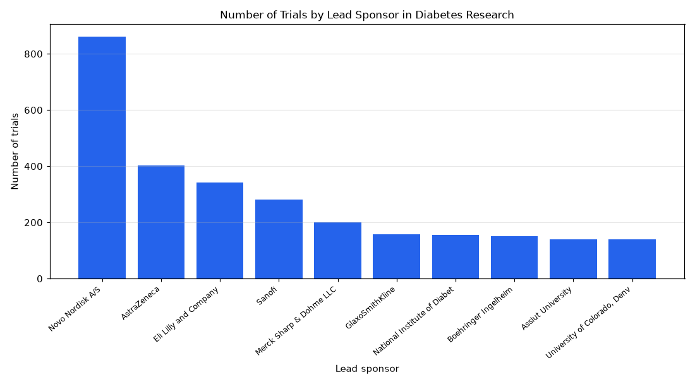

# 084. Which sponsors have more than 50 trials in diabetes?

**Question:** Which sponsors have more than 50 trials in diabetes?

Asked in **live** mode against `https://api.cheiron.engineeradriel.com` on 2026-10-24 22:53 UTC. [Open in the web app](https://trials.cheiron.engineeradriel.com/?q=Which+sponsors+have+more+than+50+trials+in+diabetes%3F&mode=live).

## Answer

- **Status:** `ok` (HTTP 200)
- **Time to answer:** 87.1 s
- **Title:** Number of Trials by Lead Sponsor in Diabetes Research
- **Chart:** `bar_chart`
- **Interpretation:** intent `top_n`, dimension `sponsor`, measure `trial_count`
- **Filters:** `{"conditions": ["diabetes"]}`
- **Trials counted:** 24,561
- **ClinicalTrials.gov data of:** 2026-10-23T09:00:04

## Chart

## Data

| Lead sponsor | Number of trials |
|---|---|
| Novo Nordisk A/S | 862 |
| AstraZeneca | 403 |
| Eli Lilly and Company | 342 |
| Sanofi | 282 |
| Merck Sharp & Dohme LLC | 200 |
| GlaxoSmithKline | 158 |
| National Institute of Diabetes and Digestive and Kidney Diseases (NIDDK) | 155 |
| Boehringer Ingelheim | 152 |
| Assiut University | 139 |
| University of Colorado, Denver | 139 |

## Counting rule

Each trial is counted once.

## Assumptions

- Show sponsors with more than 50 matching trials.

## Notes

- Showing the top 10 of 5317 lead sponsors.

## Sample citations

- `novo nordisk a/s`: [NCT05714683](https://clinicaltrials.gov/study/NCT05714683) Regulatory Post Marketing Surveillance (rPMS) Study of Rybelsus (Oral Semaglutide) to Evaluate Safety and Effe
- `astrazeneca`: [NCT07776509](https://clinicaltrials.gov/study/NCT07776509) A Study to Evaluate Effect of AZD6234 as an Adjunct to Incretin-based Therapies in Adult Participants With Obe
- `eli lilly and company`: [NCT07881432](https://clinicaltrials.gov/study/NCT07881432) A Study of EloraTZP in Adult Participants With Obesity Without Type 2 Diabetes
- `sanofi`: [NCT07360080](https://clinicaltrials.gov/study/NCT07360080) Long-Term Outcomes of Teplizumab in Routine Clinical Care
- `merck sharp & dohme llc`: [NCT07705607](https://clinicaltrials.gov/study/NCT07705607) A Clinical Trial of MK-8748 Compared to Aflibercept in Participants With Diabetic Macular Edema (MK-8748-005)

## ClinicalTrials.gov queries

- [search](https://clinicaltrials.gov/api/v2/studies?query.cond=%22diabetes%22): 24,561 trials

## Timings (ms)

`{"plan": 6848, "count": 5244, "retrieve": 73137, "aggregate": 681, "narrate": 910, "total": 86827}`
