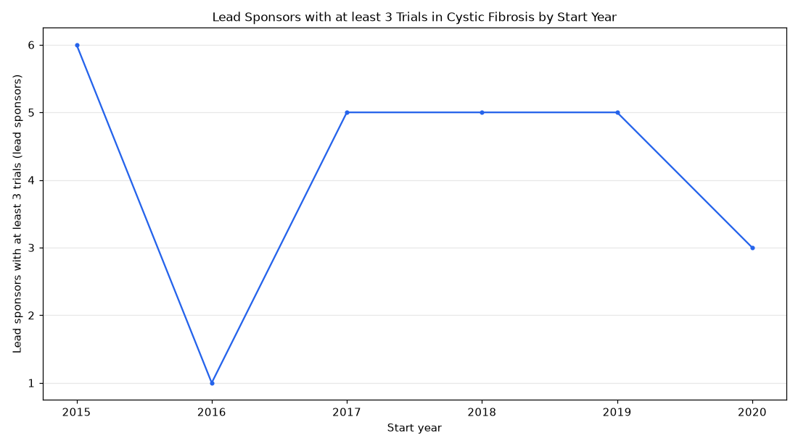

# 085. Number of sponsors with over 2 trials per year in cystic fibrosis from 2015 to 2020

**Question:** Number of sponsors with over 2 trials per year in cystic fibrosis from 2015 to 2020

Asked in **live** mode against `https://api.cheiron.engineeradriel.com` on 2026-10-24 23:05 UTC. [Open in the web app](https://trials.cheiron.engineeradriel.com/?q=Number+of+sponsors+with+over+2+trials+per+year+in+cystic+fibrosis+from+2015+to+2020&mode=live).

## Answer

- **Status:** `ok` (HTTP 200)
- **Time to answer:** 7.4 s
- **Title:** Lead Sponsors with at least 3 Trials in Cystic Fibrosis by Start Year
- **Chart:** `time_series`
- **Interpretation:** intent `trend`, dimension `start_year`, measure `distinct_count`
- **Filters:** `{"conditions": ["cystic fibrosis"], "start_year_min": 2015, "start_year_max": 2020}`
- **Trials counted:** 576
- **ClinicalTrials.gov data of:** 2026-10-23T09:00:04

## Chart

## Data

| Start year | Lead sponsors with at least 3 trials (lead sponsors) | estimated_count | citation_count |
|---|---|---|---|
| 2015 | 6 | 0 | 26 |
| 2016 | 1 | 0 | 13 |
| 2017 | 5 | 0 | 21 |
| 2018 | 5 | 0 | 25 |
| 2019 | 5 | 1 | 20 |
| 2020 | 3 | 0 | 11 |

## Counting rule

Each value is the number of distinct lead sponsors with at least 3 matching trials in each start year; their trials are the citations.

## Assumptions

- Interpreting 'over 2 trials per year' as sponsors with at least 3 trials in a given year.

## Notes

- The year filter excludes trials without a start date.

## Sample citations

- `2015`: [NCT02626182](https://clinicaltrials.gov/study/NCT02626182) Evaluation and Treatment of Pulmonary Vascular Disease in Moderate to Severe CF
- `2016`: [NCT02971839](https://clinicaltrials.gov/study/NCT02971839) Study to Evaluate the Safety and Efficacy of CTP-656 in Patients With Cystic Fibrosis With CFTR Gating Mutatio
- `2017`: [NCT03424252](https://clinicaltrials.gov/study/NCT03424252) An Phase 1 Study to Evaluate the Pharmacokinetic (PK) Profile of FDL169 New Formulations in Healthy Subjects
- `2018`: [NCT03993600](https://clinicaltrials.gov/study/NCT03993600) New Markers of Cystic Fibrosis Transmembrane Conductance Regulator (CFTR) Function in Sweat
- `2019`: [NCT03894657](https://clinicaltrials.gov/study/NCT03894657) Validation of Respiratory Epithelial Functional Assessment to Predict Clinical Efficacy of Orkambi®.

## ClinicalTrials.gov queries

- [search](https://clinicaltrials.gov/api/v2/studies?filter.advanced=AREA%5BStartDate%5DRANGE%5B2015-01-01%2C2020-12-31%5D&query.cond=%22cystic+fibrosis%22): 576 trials

## Timings (ms)

`{"plan": 5472, "count": 212, "retrieve": 558, "aggregate": 15, "narrate": 1029, "total": 7297}`
