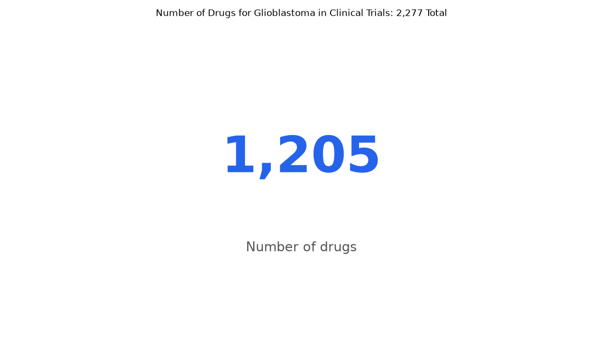

# 086. How many distinct drugs are tested in glioblastoma trials?

**Question:** How many distinct drugs are tested in glioblastoma trials?

Asked in **live** mode against `https://api.cheiron.engineeradriel.com` on 2026-10-24 22:52 UTC. [Open in the web app](https://trials.cheiron.engineeradriel.com/?q=How+many+distinct+drugs+are+tested+in+glioblastoma+trials%3F&mode=live).

## Answer

- **Status:** `ok` (HTTP 200)
- **Time to answer:** 20.5 s
- **Title:** Number of Drugs for Glioblastoma in Clinical Trials: 2,277 Total
- **Chart:** `metric`
- **Interpretation:** intent `single_number`, measure `distinct_count`
- **Filters:** `{"conditions": ["glioblastoma"]}`
- **Trials counted:** 2,277
- **ClinicalTrials.gov data of:** 2026-10-23T09:00:04

## Chart

## Data

| Number of drugs | citation_count |
|---|---|
| 1,205 | 1,726 |

## Counting rule

Each value is the number of distinct drugs with at least 1 matching trial in the matching trials; their trials are the citations.

## Assumptions

- Counted distinct drugs across trials matching the condition term glioblastoma.

## Sample citations

- `all`: [NCT07751744](https://clinicaltrials.gov/study/NCT07751744) Phase 1/2 Study Evaluating the Safety, PK/PD, and Clinical Activity of Oral JBI-778 in Patients With Brain Met

## ClinicalTrials.gov queries

- [search](https://clinicaltrials.gov/api/v2/studies?query.cond=%22glioblastoma%22): 2,277 trials

## Timings (ms)

`{"plan": 2006, "count": 7041, "retrieve": 10155, "aggregate": 162, "narrate": 914, "total": 20286}`
