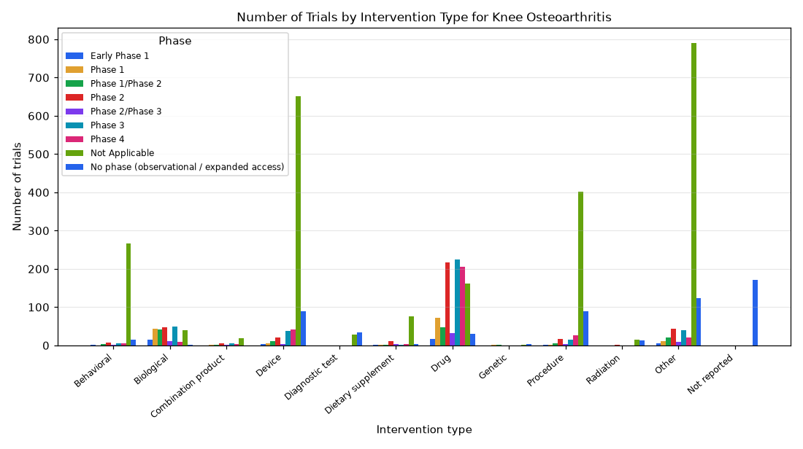

# 088. Trials for knee osteoarthritis by intervention type and phase

**Question:** Trials for knee osteoarthritis by intervention type and phase

Asked in **live** mode against `https://api.cheiron.engineeradriel.com` on 2026-10-24 22:51 UTC. [Open in the web app](https://trials.cheiron.engineeradriel.com/?q=Trials+for+knee+osteoarthritis+by+intervention+type+and+phase&mode=live).

## Answer

- **Status:** `ok` (HTTP 200)
- **Time to answer:** 29.6 s
- **Title:** Number of Trials by Intervention Type for Knee Osteoarthritis
- **Chart:** `grouped_bar_chart`
- **Interpretation:** intent `comparison`, dimension `intervention_type`, dimension_2 `phase`, measure `trial_count`
- **Filters:** `{"conditions": ["knee osteoarthritis"]}`
- **Trials counted:** 3,827
- **ClinicalTrials.gov data of:** 2026-10-23T09:00:04

## Chart

## Data

| Intervention type | Phase | Number of trials |
|---|---|---|
| Behavioral | Early Phase 1 | 1 |
| Biological | Early Phase 1 | 14 |
| Combination product | Early Phase 1 | 0 |
| Device | Early Phase 1 | 4 |
| Diagnostic test | Early Phase 1 | 0 |
| Dietary supplement | Early Phase 1 | 1 |
| Drug | Early Phase 1 | 17 |
| Genetic | Early Phase 1 | 0 |
| Procedure | Early Phase 1 | 1 |
| Radiation | Early Phase 1 | 0 |
| Other | Early Phase 1 | 5 |
| Not reported | Early Phase 1 | 0 |
| Behavioral | Phase 1 | 0 |
| Biological | Phase 1 | 43 |
| Combination product | Phase 1 | 2 |
| Device | Phase 1 | 6 |
| Diagnostic test | Phase 1 | 0 |
| Dietary supplement | Phase 1 | 1 |
| Drug | Phase 1 | 73 |
| Genetic | Phase 1 | 1 |
| Procedure | Phase 1 | 1 |
| Radiation | Phase 1 | 0 |
| Other | Phase 1 | 11 |
| Not reported | Phase 1 | 0 |
| Behavioral | Phase 1/Phase 2 | 4 |
| Biological | Phase 1/Phase 2 | 41 |
| Combination product | Phase 1/Phase 2 | 2 |
| Device | Phase 1/Phase 2 | 12 |
| Diagnostic test | Phase 1/Phase 2 | 0 |
| Dietary supplement | Phase 1/Phase 2 | 2 |
| Drug | Phase 1/Phase 2 | 48 |
| Genetic | Phase 1/Phase 2 | 2 |
| Procedure | Phase 1/Phase 2 | 5 |
| Radiation | Phase 1/Phase 2 | 0 |
| Other | Phase 1/Phase 2 | 20 |
| Not reported | Phase 1/Phase 2 | 0 |
| Behavioral | Phase 2 | 8 |
| Biological | Phase 2 | 47 |
| Combination product | Phase 2 | 5 |
| Device | Phase 2 | 20 |

_68 more rows in the API response._

## Counting rule

Each trial is counted once per distinct intervention type it lists.

## Assumptions

- Intervention type and phase are being compared for trials with condition exactly as stated by the user.

## Sample citations

- `Early Phase 1|BEHAVIORAL`: [NCT07837284](https://clinicaltrials.gov/study/NCT07837284) Medication vs. Meditation for Chronic Knee Osteoarthritis
- `Early Phase 1|BIOLOGICAL`: [NCT07453953](https://clinicaltrials.gov/study/NCT07453953) A Comparison of Clinical Efficacy of Mytocel MSK With AMT and PRP Injections in Patients With Knee Osteoarthri
- `Early Phase 1|DEVICE`: [NCT07769632](https://clinicaltrials.gov/study/NCT07769632) Total Osteo-Cartilage Replacement for the Treatment of Osteoarthritis of Knee
- `Early Phase 1|DIETARY_SUPPLEMENT`: [NCT01909037](https://clinicaltrials.gov/study/NCT01909037) Exploratory Non Comparative Study to Evaluate the Efficacy of Highly Bioavailable Curcumin (Flexofytol) in Pat
- `Early Phase 1|DRUG`: [NCT07837284](https://clinicaltrials.gov/study/NCT07837284) Medication vs. Meditation for Chronic Knee Osteoarthritis

## ClinicalTrials.gov queries

- [search](https://clinicaltrials.gov/api/v2/studies?query.cond=%22knee+osteoarthritis%22): 3,827 trials

## Timings (ms)

`{"plan": 2027, "count": 5059, "retrieve": 20794, "aggregate": 511, "narrate": 657, "total": 29057}`
