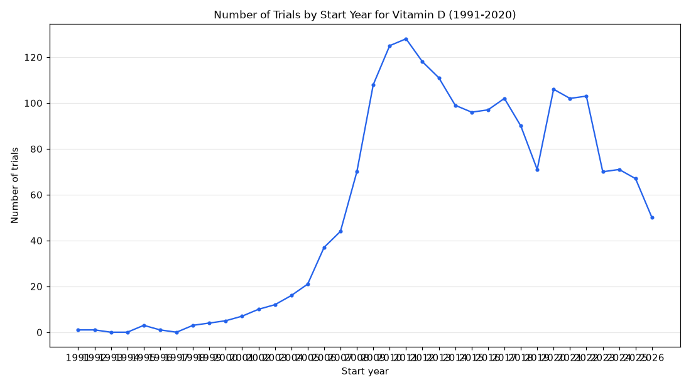

# 090. Dietary supplement trials for vitamin D by start year

**Question:** Dietary supplement trials for vitamin D by start year

Asked in **live** mode against `https://api.cheiron.engineeradriel.com` on 2026-10-24 22:51 UTC. [Open in the web app](https://trials.cheiron.engineeradriel.com/?q=Dietary+supplement+trials+for+vitamin+D+by+start+year&mode=live).

## Answer

- **Status:** `ok` (HTTP 200)
- **Time to answer:** 18.1 s
- **Title:** Number of Trials by Start Year for Vitamin D (1991-2020)
- **Chart:** `time_series`
- **Interpretation:** intent `trend`, dimension `start_year`, measure `trial_count`
- **Filters:** `{"drugs": ["vitamin D"]}`
- **Trials counted:** 1,949
- **ClinicalTrials.gov data of:** 2026-10-23T09:00:04

## Chart

## Data

| Start year | Number of trials | estimated_count |
|---|---|---|
| 1991 | 1 | 0 |
| 1992 | 1 | 0 |
| 1993 | 0 | 0 |
| 1994 | 0 | 0 |
| 1995 | 3 | 0 |
| 1996 | 1 | 0 |
| 1997 | 0 | 0 |
| 1998 | 3 | 0 |
| 1999 | 4 | 0 |
| 2000 | 5 | 0 |
| 2001 | 7 | 0 |
| 2002 | 10 | 0 |
| 2003 | 12 | 0 |
| 2004 | 16 | 0 |
| 2005 | 21 | 0 |
| 2006 | 37 | 0 |
| 2007 | 44 | 0 |
| 2008 | 70 | 0 |
| 2009 | 108 | 0 |
| 2010 | 125 | 0 |
| 2011 | 128 | 0 |
| 2012 | 118 | 0 |
| 2013 | 111 | 0 |
| 2014 | 99 | 0 |
| 2015 | 96 | 0 |
| 2016 | 97 | 0 |
| 2017 | 102 | 5 |
| 2018 | 90 | 6 |
| 2019 | 71 | 7 |
| 2020 | 106 | 11 |
| 2021 | 102 | 12 |
| 2022 | 103 | 15 |
| 2023 | 70 | 13 |
| 2024 | 71 | 13 |
| 2025 | 67 | 15 |
| 2026 | 50 | 20 |

## Counting rule

Each trial is counted once, in the year it started (or is expected to start).

## Assumptions

- Interpreting 'dietary supplement trials' as trials involving vitamin D listed in ClinicalTrials.gov.

## Left out

- 4 trials: start after 2026
- 7 trials: no start date

## Sample citations

- `1991`: [NCT00001304](https://clinicaltrials.gov/study/NCT00001304) Treatment of Hypoparathyroidism With Synthetic Human Parathyroid Hormone 1-34
- `1992`: [NCT00357643](https://clinicaltrials.gov/study/NCT00357643) Effect of Calcium and Vitamin D on Bone Loss From the Hip
- `1995`: [NCT00570934](https://clinicaltrials.gov/study/NCT00570934) Supplementation With Vitamin D, Calcium or Both on Calcium Absorption and Bone Mineral Content in Children Wit
- `1996`: [NCT00670501](https://clinicaltrials.gov/study/NCT00670501) Effects of Teriparatide in the Treatment of Postmenopausal Women With Osteoporosis
- `1998`: [NCT00004488](https://clinicaltrials.gov/study/NCT00004488) Phase II Randomized Study of Alendronate Sodium for Osteopenia in Patients With Gaucher's Disease

## ClinicalTrials.gov queries

- [search](https://clinicaltrials.gov/api/v2/studies?filter.advanced=AREA%5BInterventionNameSearch%5D%22vitamin+D%22): 1,960 trials

## Timings (ms)

`{"plan": 4555, "count": 8687, "retrieve": 3811, "aggregate": 66, "narrate": 692, "total": 17820}`
