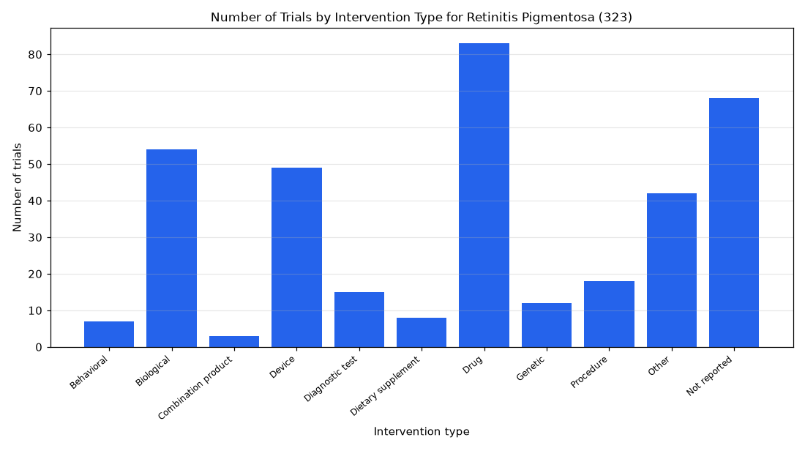

# 092. Genetic intervention trials for retinitis pigmentosa

**Question:** Genetic intervention trials for retinitis pigmentosa

Asked in **live** mode against `https://api.cheiron.engineeradriel.com` on 2026-10-24 22:51 UTC. [Open in the web app](https://trials.cheiron.engineeradriel.com/?q=Genetic+intervention+trials+for+retinitis+pigmentosa&mode=live).

## Answer

- **Status:** `ok` (HTTP 200)
- **Time to answer:** 16.6 s
- **Title:** Number of Trials by Intervention Type for Retinitis Pigmentosa (323)
- **Chart:** `bar_chart`
- **Interpretation:** intent `distribution`, dimension `intervention_type`, measure `trial_count`
- **Filters:** `{"conditions": ["retinitis pigmentosa"]}`
- **Trials counted:** 323
- **ClinicalTrials.gov data of:** 2026-10-23T09:00:04

## Chart

## Data

| Intervention type | Number of trials |
|---|---|
| Behavioral | 7 |
| Biological | 54 |
| Combination product | 3 |
| Device | 49 |
| Diagnostic test | 15 |
| Dietary supplement | 8 |
| Drug | 83 |
| Genetic | 12 |
| Procedure | 18 |
| Other | 42 |
| Not reported | 68 |

## Counting rule

Each trial is counted once per distinct intervention type it lists.

## Assumptions

- The chart shows trial counts by intervention type for retinitis pigmentosa trials; 'genetic' is one intervention type category.

## Sample citations

- `BEHAVIORAL`: [NCT07292987](https://clinicaltrials.gov/study/NCT07292987) Implementation and Evaluation of a Post-Diagnostic Announcement Protocol at the CRMR RefeRet, Quinze-Vingts Ho
- `BIOLOGICAL`: [NCT05786287](https://clinicaltrials.gov/study/NCT05786287) Long-term Safety of UC-MSC Transplantation in Patients With Retinitis Pigmentosa
- `COMBINATION_PRODUCT`: [NCT03326336](https://clinicaltrials.gov/study/NCT03326336) Dose-escalation Study to Evaluate the Safety and Tolerability of GS030 in Subjects With Retinitis Pigmentosa
- `DEVICE`: [NCT05914233](https://clinicaltrials.gov/study/NCT05914233) Non-invasive Ultrasound Retinal Stimulation for Vision Restoration
- `DIAGNOSTIC_TEST`: [NCT07228793](https://clinicaltrials.gov/study/NCT07228793) Natural History Study of Patients With EYS-Associated RP

## ClinicalTrials.gov queries

- [search](https://clinicaltrials.gov/api/v2/studies?query.cond=%22retinitis+pigmentosa%22): 323 trials

## Timings (ms)

`{"plan": 7096, "count": 6387, "retrieve": 1776, "aggregate": 10, "narrate": 1083, "total": 16361}`
