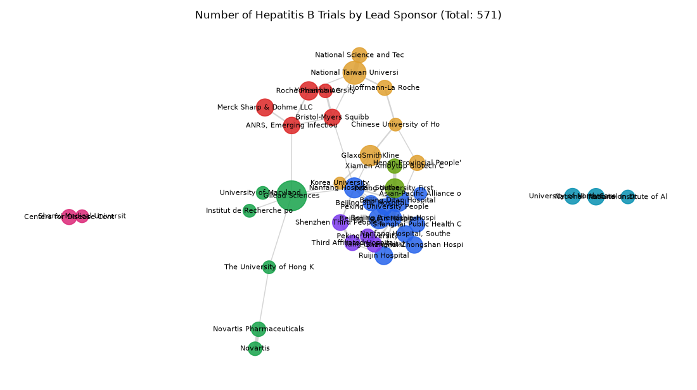

# 093. Sponsor network for hepatitis B trials

**Question:** Sponsor network for hepatitis B trials

Asked in **live** mode against `https://api.cheiron.engineeradriel.com` on 2026-10-24 22:53 UTC. [Open in the web app](https://trials.cheiron.engineeradriel.com/?q=Sponsor+network+for+hepatitis+B+trials&mode=live).

## Answer

- **Status:** `ok` (HTTP 200)
- **Time to answer:** 14.5 s
- **Title:** Number of Hepatitis B Trials by Lead Sponsor (Total: 571)
- **Chart:** `network_graph`
- **Interpretation:** intent `network`, dimension `sponsor`, dimension_2 `collaborator`, measure `trial_count`
- **Filters:** `{"conditions": ["hepatitis B"]}`
- **Trials counted:** 571
- **ClinicalTrials.gov data of:** 2026-10-23T09:00:04

## Chart

## Data

**Largest nodes** (trials)

| Entity | Type | Trials | Links |
|---|---|---:|---:|
| Gilead Sciences | collaborator | 39 | 6 |
| National Taiwan University Hospital | sponsor | 22 | 4 |
| Beijing Ditan Hospital | collaborator | 21 | 3 |
| GlaxoSmithKline | collaborator | 17 | 3 |
| Beijing YouAn Hospital | collaborator | 16 | 2 |
| Nanfang Hospital, Southern Medical University | sponsor | 16 | 8 |
| Peking University First Hospital | collaborator | 14 | 2 |
| Roche Pharma AG | collaborator | 13 | 3 |
| Ruijin Hospital | collaborator | 12 | 2 |
| Merck Sharp & Dohme LLC | collaborator | 11 | 1 |
| Bristol-Myers Squibb | collaborator | 10 | 4 |
| Nanfang Hospital, Southern Medical University | collaborator | 10 | 1 |
| National Institute on Drug Abuse (NIDA) | collaborator | 10 | 2 |
| Shanghai Zhongshan Hospital | collaborator | 10 | 1 |
| ANRS, Emerging Infectious Diseases | sponsor | 10 | 4 |

**Strongest links** (shared trials)

| From | To | Shared trials |
|---|---|---:|
| Beijing Ditan Hospital | Beijing Friendship Hospital | 8 |
| Beijing YouAn Hospital | Beijing Friendship Hospital | 8 |
| National Science and Technology Council, Taiwan | National Taiwan University Hospital | 8 |
| Peking University People's Hospital | Beijing Friendship Hospital | 7 |
| Nanfang Hospital, Southern Medical University | Beijing Friendship Hospital | 6 |
| Novartis Pharmaceuticals | Novartis | 6 |
| Peking University First Hospital | Beijing Friendship Hospital | 6 |
| Peking University First Hospital | Xiamen Amoytop Biotech Co., Ltd. | 6 |
| Beijing Ditan Hospital | Asian-Pacific Alliance of Liver Disease, Beijing | 5 |
| Centers for Disease Control and Prevention, China | Shanxi Medical University | 5 |
| Shanghai Public Health Clinical Center | Beijing Friendship Hospital | 5 |
| Beijing 302 Hospital | Beijing Friendship Hospital | 4 |
| National Institute on Drug Abuse (NIDA) | University of North Carolina, Chapel Hill | 4 |
| Peking University | Third Affiliated Hospital, Sun Yat-Sen University | 4 |
| Shenzhen Third People's Hospital | Third Affiliated Hospital, Sun Yat-Sen University | 4 |

## Counting rule

Node size = distinct trials with that entity; edge width = distinct trials with both.

## Assumptions

- Interpreting 'sponsor network' as a network between lead sponsors and collaborators for hepatitis B trials.

## Sample citations

- `collaborator:gilead sciences`: [NCT07560046](https://clinicaltrials.gov/study/NCT07560046) Combating Related Epidemics in HCV
- `collaborator:beijing ditan hospital`: [NCT07780357](https://clinicaltrials.gov/study/NCT07780357) HCC Risk Prediction Model Based on Multimodal Data in Chronic Hepatitis B
- `collaborator:glaxosmithkline`: [NCT02985450](https://clinicaltrials.gov/study/NCT02985450) A Prospective Study of HBV Immunity and HBV Vaccination in Patients With NAFLD in Canada
- `collaborator:beijing youan hospital`: [NCT05937178](https://clinicaltrials.gov/study/NCT05937178) Real-world Study Optimizing Nucleotide-analogues
- `collaborator:peking university first hospital`: [NCT05937178](https://clinicaltrials.gov/study/NCT05937178) Real-world Study Optimizing Nucleotide-analogues

## ClinicalTrials.gov queries

- [search](https://clinicaltrials.gov/api/v2/studies?query.cond=%22hepatitis+B%22): 2,013 trials

## Timings (ms)

`{"plan": 4188, "count": 210, "retrieve": 8998, "aggregate": 96, "narrate": 874, "total": 14374}`
