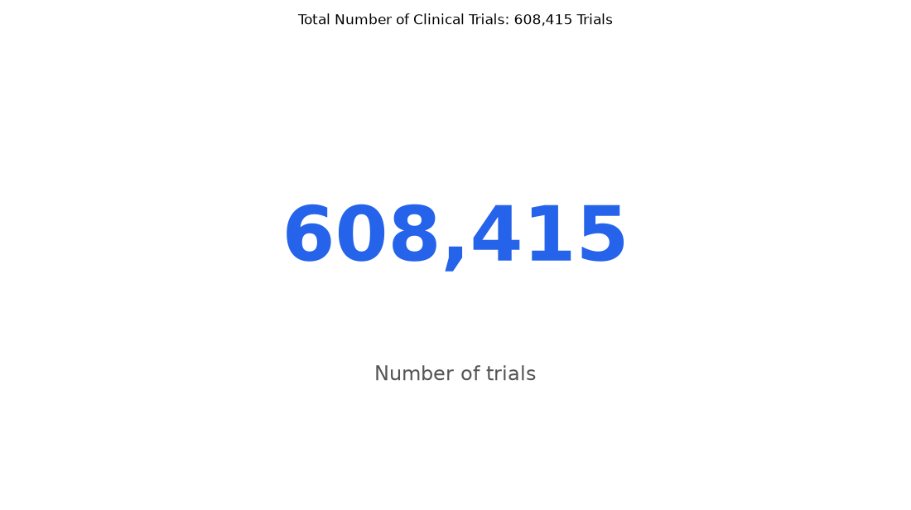

# 094. How many trials are there in total on ClinicalTrials.gov?

**Question:** How many trials are there in total on ClinicalTrials.gov?

Asked in **live** mode against `https://api.cheiron.engineeradriel.com` on 2026-10-24 23:33 UTC. [Open in the web app](https://trials.cheiron.engineeradriel.com/?q=How+many+trials+are+there+in+total+on+ClinicalTrials.gov%3F&mode=live).

## Answer

- **Status:** `ok` (HTTP 200, ran as a background job)
- **Time to answer:** 739.9 s
- **Title:** Total Number of Clinical Trials: 608,415 Trials
- **Chart:** `metric`
- **Interpretation:** intent `single_number`, measure `trial_count`
- **Trials counted:** 608,415
- **ClinicalTrials.gov data of:** 2026-10-23T09:00:04

## Chart

## Data

| Number of trials |
|---|
| 608,415 |

## Counting rule

Each matching trial is counted once.

## Sample citations

- `all`: [NCT05945147](https://clinicaltrials.gov/study/NCT05945147) Ketamine and Midazolam Infusions for CRPS: Feasibility Study

## ClinicalTrials.gov queries

- [search](https://clinicaltrials.gov/api/v2/studies?): 608,415 trials

## Timings (ms)

`{"plan": 1746, "count": 0, "total": 698221, "narrate": 1195, "retrieve": 675972, "aggregate": 19306}`
