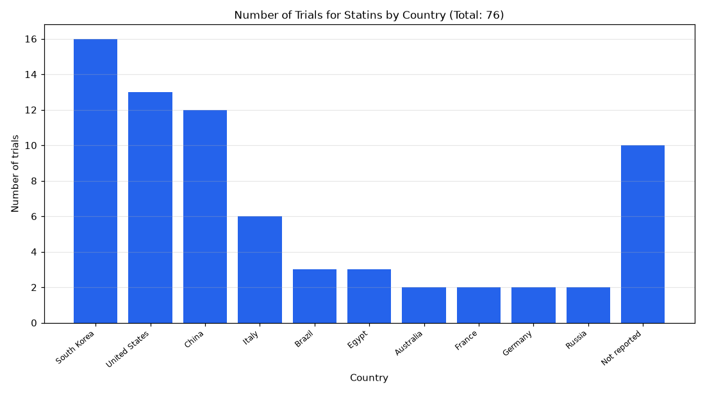

# 095. Phase 4 trials of statins by country

**Question:** Phase 4 trials of statins by country

Asked in **live** mode against `https://api.cheiron.engineeradriel.com` on 2026-10-24 22:52 UTC. [Open in the web app](https://trials.cheiron.engineeradriel.com/?q=Phase+4+trials+of+statins+by+country&mode=live).

## Answer

- **Status:** `ok` (HTTP 200)
- **Time to answer:** 6.0 s
- **Title:** Number of Trials for Statins by Country (Total: 76)
- **Chart:** `bar_chart`
- **Interpretation:** intent `comparison`, dimension `country`, measure `trial_count`
- **Filters:** `{"drugs": ["statins"], "phases": ["PHASE4"]}`
- **Trials counted:** 76
- **ClinicalTrials.gov data of:** 2026-10-23T09:00:04

## Chart

## Data

| Country | Number of trials |
|---|---|
| South Korea | 16 |
| United States | 13 |
| China | 12 |
| Italy | 6 |
| Brazil | 3 |
| Egypt | 3 |
| Australia | 2 |
| France | 2 |
| Germany | 2 |
| Russia | 2 |
| Not reported | 10 |

## Counting rule

Each trial is counted once per country where it has at least one site.

## Assumptions

- Interpreting "statins" as the drug term entered by the user.
- Using lead sponsor role by default.

## Notes

- Showing the top 10 of 28 countries.

## Sample citations

- `South Korea`: [NCT06676280](https://clinicaltrials.gov/study/NCT06676280) ASpirin Use and stAtin Strategy for Primary Prevention in Severe Coronary Calcium Score on Computed Tomography
- `United States`: [NCT06280976](https://clinicaltrials.gov/study/NCT06280976) Aggressive Risk-Prevention Therapies for Coronary Atherosclerotic Plaque (ART-CAP)
- `China`: [NCT06902740](https://clinicaltrials.gov/study/NCT06902740) PCSK9 Inhibitor With Statin Therapy for Asymptomatic Intracranial Atherosclerosis
- `Italy`: [NCT05122780](https://clinicaltrials.gov/study/NCT05122780) Prognostic Value of Precision Medicine in Patients With MINOCA (PROMISE Trial).
- `Brazil`: [NCT02642159](https://clinicaltrials.gov/study/NCT02642159) Efficacy and Safety of Alirocumab Versus Usual Care on Top of Maximally Tolerated Statin Therapy in Patients W

## ClinicalTrials.gov queries

- [search](https://clinicaltrials.gov/api/v2/studies?filter.advanced=%28AREA%5BInterventionNameSearch%5D%22statins%22+AND+AREA%5BPhase%5DPHASE4%29): 76 trials

## Timings (ms)

`{"plan": 2230, "count": 2659, "retrieve": 354, "aggregate": 3, "narrate": 708, "total": 5962}`
