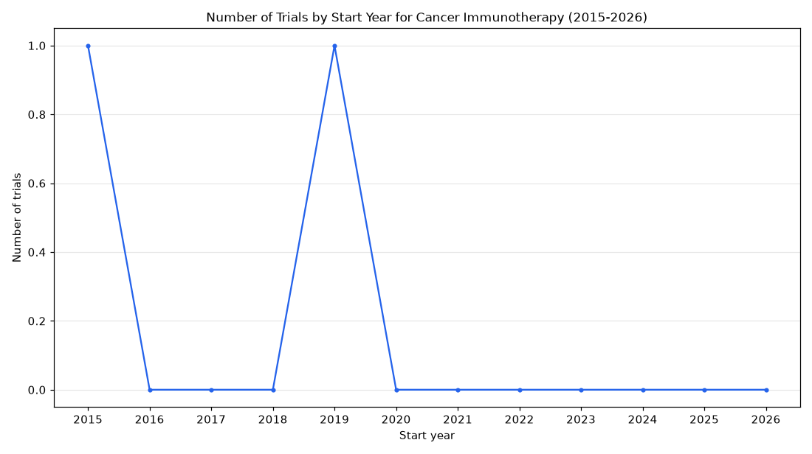

# 096. Trials with withdrawn status for cancer immunotherapy by year

**Question:** Trials with withdrawn status for cancer immunotherapy by year

Asked in **live** mode against `https://api.cheiron.engineeradriel.com` on 2026-10-24 22:49 UTC. [Open in the web app](https://trials.cheiron.engineeradriel.com/?q=Trials+with+withdrawn+status+for+cancer+immunotherapy+by+year&mode=live).

## Answer

- **Status:** `ok` (HTTP 200)
- **Time to answer:** 14.7 s
- **Title:** Number of Trials by Start Year for Cancer Immunotherapy (2015-2026)
- **Chart:** `time_series`
- **Interpretation:** intent `trend`, dimension `start_year`, measure `trial_count`
- **Filters:** `{"conditions": ["cancer immunotherapy"], "statuses": ["WITHDRAWN"]}`
- **Trials counted:** 2
- **ClinicalTrials.gov data of:** 2026-10-23T09:00:04

## Chart

## Data

| Start year | Number of trials | estimated_count |
|---|---|---|
| 2015 | 1 | 0 |
| 2016 | 0 | 0 |
| 2017 | 0 | 0 |
| 2018 | 0 | 0 |
| 2019 | 1 | 1 |
| 2020 | 0 | 0 |
| 2021 | 0 | 0 |
| 2022 | 0 | 0 |
| 2023 | 0 | 0 |
| 2024 | 0 | 0 |
| 2025 | 0 | 0 |
| 2026 | 0 | 0 |

## Counting rule

Each trial is counted once, in the year it started (or is expected to start).

## Assumptions

- 'by year' is interpreted as trial start year.

## Warnings

- Most trials in 2019 have estimated (planned) dates.

## Sample citations

- `2015`: [NCT01530984](https://clinicaltrials.gov/study/NCT01530984) Ipilimumab and GMCSF Immunotherapy for Prostate Cancer
- `2019`: [NCT02921373](https://clinicaltrials.gov/study/NCT02921373) Tracking Peripheral Blood Mononuclear Cells With Fluorine MRI

## ClinicalTrials.gov queries

- [search](https://clinicaltrials.gov/api/v2/studies?filter.overallStatus=WITHDRAWN&query.cond=%22cancer+immunotherapy%22): 2 trials

## Timings (ms)

`{"plan": 2775, "count": 8858, "retrieve": 1707, "aggregate": 4, "narrate": 1158, "total": 14582}`
