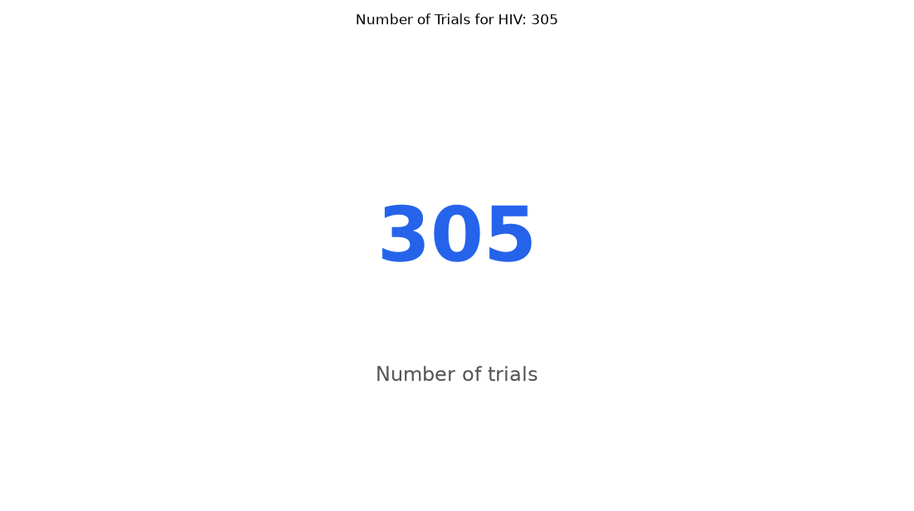

# 097. How many NIH-funded trials study HIV prevention?

**Question:** How many NIH-funded trials study HIV prevention?

Asked in **live** mode against `https://api.cheiron.engineeradriel.com` on 2026-10-24 22:51 UTC. [Open in the web app](https://trials.cheiron.engineeradriel.com/?q=How+many+NIH-funded+trials+study+HIV+prevention%3F&mode=live).

## Answer

- **Status:** `ok` (HTTP 200)
- **Time to answer:** 6.0 s
- **Title:** Number of Trials for HIV: 305
- **Chart:** `metric`
- **Interpretation:** intent `single_number`, measure `trial_count`
- **Filters:** `{"conditions": ["HIV"], "sponsor_classes": ["NIH"], "primary_purposes": ["PREVENTION"]}`
- **Trials counted:** 305
- **ClinicalTrials.gov data of:** 2026-10-23T09:00:04

## Chart

## Data

| Number of trials |
|---|
| 305 |

## Counting rule

Each matching trial is counted once.

## Assumptions

- Treating "NIH-funded" as sponsor class NIH.

## Sample citations

- `all`: [NCT07757802](https://clinicaltrials.gov/study/NCT07757802) Phase 1 Study of CH505 HIV Vaccine Nanoparticles and mRNA Boosters in Healthy Adults

## ClinicalTrials.gov queries

- [search](https://clinicaltrials.gov/api/v2/studies?filter.advanced=%28AREA%5BLeadSponsorClass%5DNIH+AND+AREA%5BDesignPrimaryPurpose%5DPREVENTION%29&query.cond=%22HIV%22): 305 trials

## Timings (ms)

`{"plan": 3167, "count": 1145, "retrieve": 888, "aggregate": 5, "narrate": 728, "total": 5942}`
