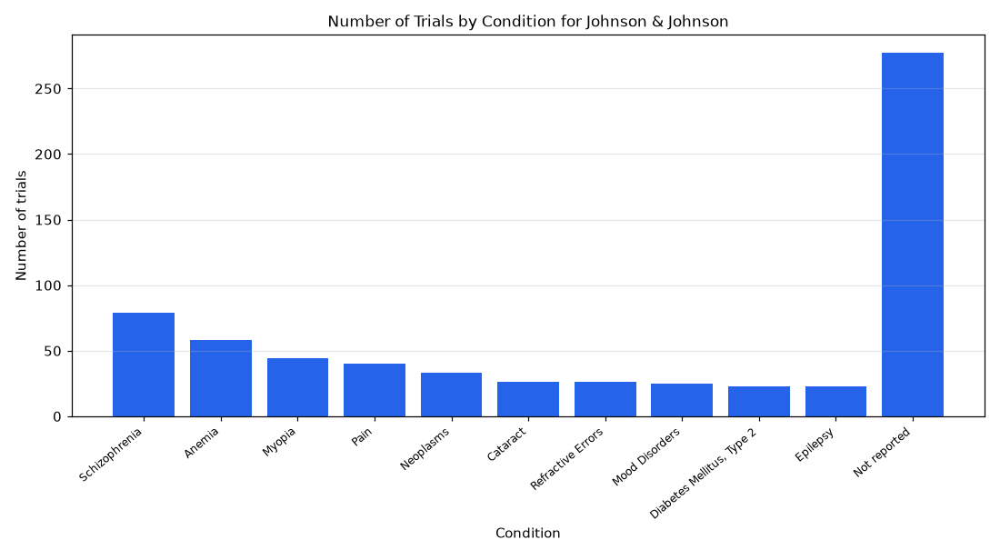

# 098. Which conditions does Johnson & Johnson study most?

**Question:** Which conditions does Johnson & Johnson study most?

Asked in **live** mode against `https://api.cheiron.engineeradriel.com` on 2026-10-24 22:50 UTC. [Open in the web app](https://trials.cheiron.engineeradriel.com/?q=Which+conditions+does+Johnson+%26+Johnson+study+most%3F&mode=live).

## Answer

- **Status:** `ok` (HTTP 200)
- **Time to answer:** 17.4 s
- **Title:** Number of Trials by Condition for Johnson & Johnson
- **Chart:** `bar_chart`
- **Interpretation:** intent `top_n`, dimension `condition`, measure `trial_count`
- **Filters:** `{"sponsors": ["Johnson & Johnson"]}`
- **Trials counted:** 919
- **ClinicalTrials.gov data of:** 2026-10-23T09:00:04

## Chart

## Data

| Condition | Number of trials |
|---|---|
| Schizophrenia | 79 |
| Anemia | 58 |
| Myopia | 44 |
| Pain | 40 |
| Neoplasms | 33 |
| Cataract | 26 |
| Refractive Errors | 26 |
| Mood Disorders | 25 |
| Diabetes Mellitus, Type 2 | 23 |
| Epilepsy | 23 |
| Not reported | 277 |

## Counting rule

Each trial is counted once per distinct condition it lists.

## Assumptions

- Interpreted 'studies' as trials with Johnson & Johnson as the lead sponsor.

## Notes

- Showing the top 10 of 318 conditions.

## Sample citations

- `schizophrenia`: [NCT01670071](https://clinicaltrials.gov/study/NCT01670071) A Study to Evaluate the Effect of Oral Paliperidone Extended-Release and Oral Risperidone Immediate-Release on
- `anemia`: [NCT00695396](https://clinicaltrials.gov/study/NCT00695396) A Study Evaluating Epoetin Alfa 40,000 IU (International Units) Every Week or 80,000 IU Every Week Compared to
- `myopia`: [NCT06075576](https://clinicaltrials.gov/study/NCT06075576) Characterization of the Central and Peripheral Wavefront Aberration Profile in Pediatric Myopic Subjects
- `pain`: [NCT05868122](https://clinicaltrials.gov/study/NCT05868122) A Study to Evaluate a Fixed Combination of Acetaminophen/Naproxen Sodium in Acute Postoperative Pain Following
- `neoplasms`: [NCT07525141](https://clinicaltrials.gov/study/NCT07525141) A Study of JNJ-1761981 in Participants With Solid Tumors

## ClinicalTrials.gov queries

- [search](https://clinicaltrials.gov/api/v2/studies?query.lead=%22Johnson+%26+Johnson%22): 919 trials

## Timings (ms)

`{"plan": 1670, "count": 5020, "retrieve": 9539, "aggregate": 29, "narrate": 854, "total": 17122}`
